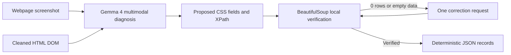

# ScrapeHeal-Gemma

**A multimodal self-healing web scraper and reusable Agent Skill.** When a website replaces a legacy table with a modern card or grid layout, ScrapeHeal-Gemma compares a screenshot with the changed DOM, asks Gemma 4 to propose new selectors, and verifies those selectors against the HTML using BeautifulSoup before reporting extracted rows.

## How it works



The dashboard has two one-click walkthroughs: a deterministic football demo and a live Books to Scrape run. The CLI returns the same JSON contract for agent workflows. The model's output is never treated as verified until the local DOM check succeeds.

## Dashboard modes: what the demo proves

### Demo: Football (reliable)

This is a controlled, repeatable walkthrough of the recovery pipeline:

1. The app runs a deliberately outdated football standings selector and shows that it matches **0 rows**.
2. When a Gemma API key is configured, the app sends the fixture screenshot and DOM to Gemma 4 and asks it to propose replacement selectors.
3. BeautifulSoup checks the proposed selectors against the fixture HTML. The app displays the repaired selector and the extracted football records only after verification succeeds.

The football page is a built-in fixture with **sample demo records**, not live football standings. The selectors are intentionally stale so judges can reproduce the failure. If no API key is configured, the demo runs in clearly labeled offline mode. If Gemma is unavailable or proposes selectors that fail verification, a locally verified preset keeps the walkthrough usable; the UI labels that fallback. A short pause makes the failure and verification stages visible, while Gemma's actual response time remains unchanged.

### Live: Books to Scrape

This mode exercises the scraper against the current first page of [Books to Scrape](https://books.toscrape.com/):

1. Upload a screenshot of that same first page. The app fetches the live HTML when you run the pipeline.
2. Gemma 4 receives the screenshot and fetched DOM, then proposes selectors for book titles, prices, and availability.
3. BeautifulSoup verifies the selectors against the fetched HTML and extracts the records. Live mode reports errors directly and never substitutes the football fixture.

Live mode requires `GEMMA_API_KEY_1` in the ignored `.env` file; `GEMMA_API_KEY_2` is tried if the first key fails. Requests can take up to two minutes. This mode needs network access, a working API key, and a screenshot that matches the fetched page.

## Open-Weight AI Model & License Compliance

- **Models used:** Google Gemma 4 `gemma-4-26b-a4b-it` and `gemma-4-31b-it`, called through the official `google-genai` Python SDK and Google AI Studio API.
- **Model license:** Apache License 2.0 ([license text](https://www.apache.org/licenses/LICENSE-2.0)); see Google's [Gemma 4 model card](https://ai.google.dev/gemma/docs/core/model_card_4) and [Gemma license information](https://ai.google.dev/gemma/apache_2).
- **Google Gemma terms:** [Gemma Terms of Use](https://ai.google.dev/gemma/terms).
- **Agent Skill Specification:** The `scrape-heal/SKILL.md` follows [agentskills.io/specification](https://agentskills.io/specification).
- **Repository license:** [Apache-2.0](LICENSE).

## Quickstart: Streamlit dashboard

```bash
# Use Python 3.10 or newer.
python3.10 -m venv .venv
source .venv/bin/activate
python -m pip install -r requirements.txt
cp .env.example .env
# Add keys as GEMMA_API_KEY_1 and GEMMA_API_KEY_2 in .env for live inference.
streamlit run app.py
```

After launch, choose a mode in the sidebar and click its run button. See [Dashboard modes](#dashboard-modes-what-the-demo-proves) for the inputs, fallback behavior, and what each run verifies.

## Quickstart: CLI Agent Skill

```bash
python -m pip install -r requirements.txt
python scrape-heal/scripts/heal_scraper.py \
  --preset football_league \
  --offline-mock \
  --output healed-results.json
```

Live custom page example:

```bash
# Configure GEMMA_API_KEY_1 (and optionally GEMMA_API_KEY_2) in .env.
python scrape-heal/scripts/heal_scraper.py \
  --html-file page.html \
  --screenshot page.png \
  --broken-selector 'table.legacy tbody tr' \
  --goal 'Extract product name, price, and stock' \
  --model gemma-4-26b-a4b-it \
  --thinking-level high \
  --output healed-results.json
```

The CLI also accepts `--url` with `--screenshot`, `--preset`, `--model`, `--thinking-level`, and `--output`. Read the [Agent Skill](scrape-heal/SKILL.md) and its [reference](scrape-heal/references/REFERENCE.md) for all arguments, JSON fields, and recovery behavior.

## Demo scenarios

| Preset | Broken legacy selector | Modern layout |
| --- | --- | --- |
| `football_league` | `table.league-standings-v1 tbody tr` | Isthmian Premier club standing cards |
| `cloud_gpu` | `table#gpu-pricing-legacy tr.instance-row` | GPU spot marketplace article cards |
| `industrial_b2b` | `ul.product-catalog-old li.item-box` | Industrial equipment cards with INR pricing |

## Development checks

```bash
python -m unittest discover -s tests -v
```

The smoke suite checks generated screenshots and mutated DOMs, zero-match legacy selectors, deterministic local extraction, DOM cleaning, and the Agent Skill frontmatter.
